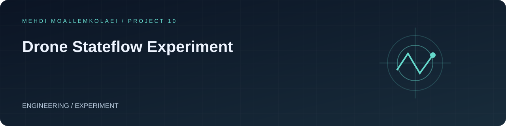

# Drone Stateflow Experiment

**Explore takeoff, forward movement and hover logic with blue-line detection.**

MATLAB · Simulink · Stateflow · Vision

[Overview](#overview) · [Design](portfolio/DESIGN.md) · [Setup](portfolio/SETUP.md) · [Validation](portfolio/VALIDATION.md) · [Evidence](portfolio/EVIDENCE.md)

## Overview

| Item | Record |
| :-- | :-- |
| Project type | Experiment |
| Field | Engineering |
| Material in this package | Documentation package; original source not included |
| Documentation review | 17 November 2026 |

## Scope

Explore takeoff, forward movement and hover logic with blue-line detection. The documentation separates the stated project scope, inspected artifacts and future work. A listed feature is not a new test result.

### Main elements

- Blue-line input
- State transitions
- Motion commands
- Hover state

## Start here

1. Read the [design record](portfolio/DESIGN.md) for the system elements and boundaries.
2. Follow the [setup record](portfolio/SETUP.md) for available entry points.
3. Use the [validation plan](portfolio/VALIDATION.md) to record reproducible results.
4. Check the [evidence register](portfolio/EVIDENCE.md) before reusing claims.

## Source status

This package contains project documentation and visual assets. Original code, CAD, data and test records have not been added. The setup record lists the files needed for a reproducible release.

## Next work

- [ ] Stateflow chart
- [ ] Transition guards
- [ ] Image input assumptions
- [ ] Run logs and simulator dependencies

## Credits and reuse

Project record: Mehdi Moallemkolaei. Specific third-party and course contributions must retain their original notices.

Existing license terms remain in effect. This package does not grant a new license over source code, course material, models or datasets. See [reuse and contribution notes](portfolio/CONTRIBUTIONS.md).
